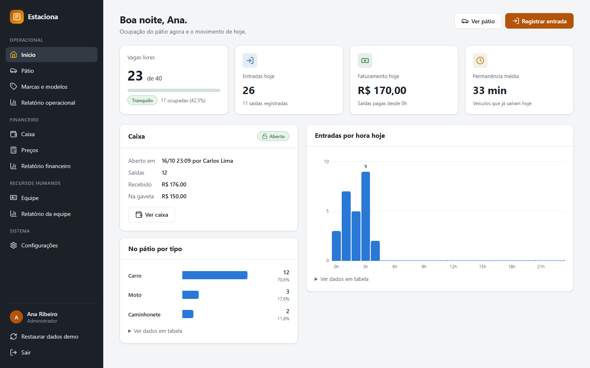
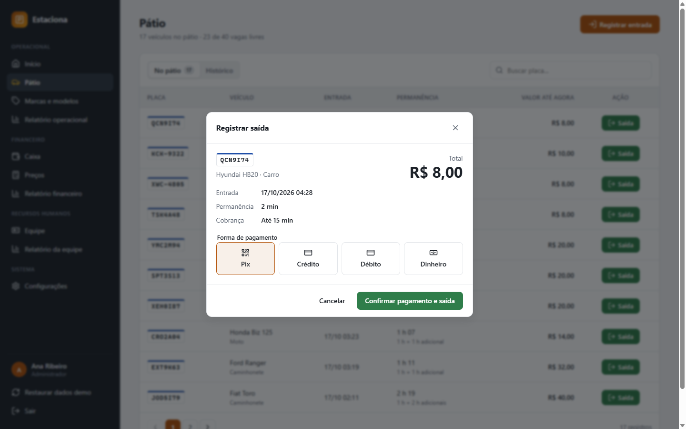
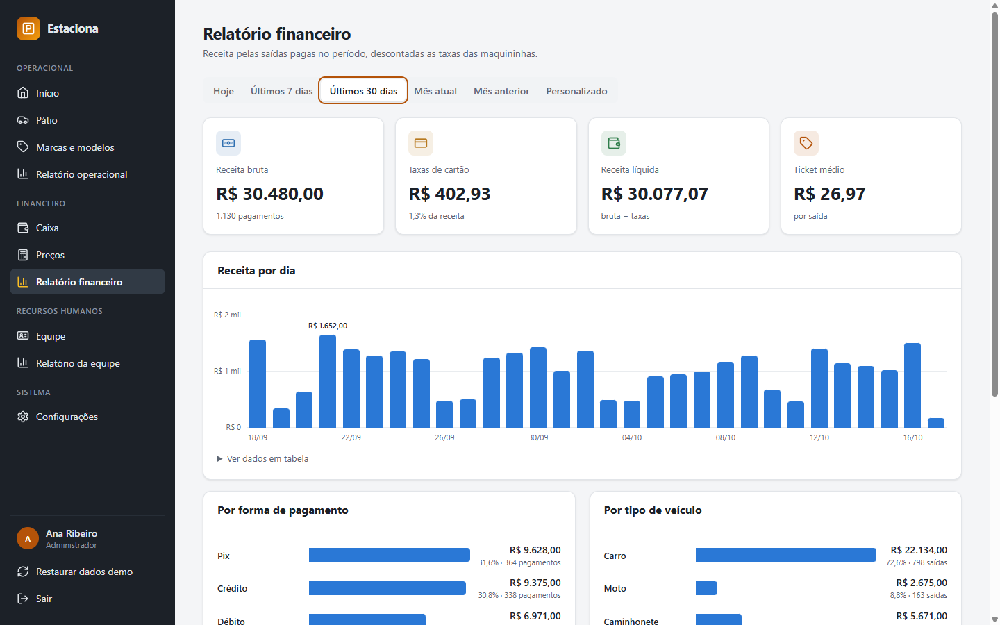
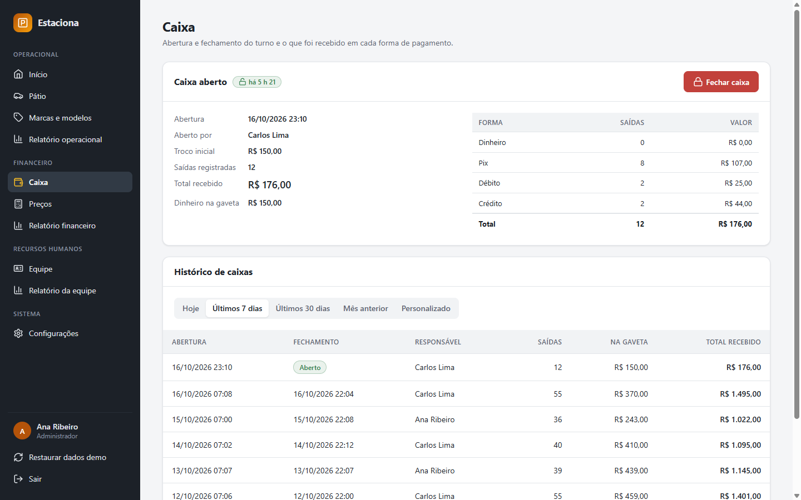
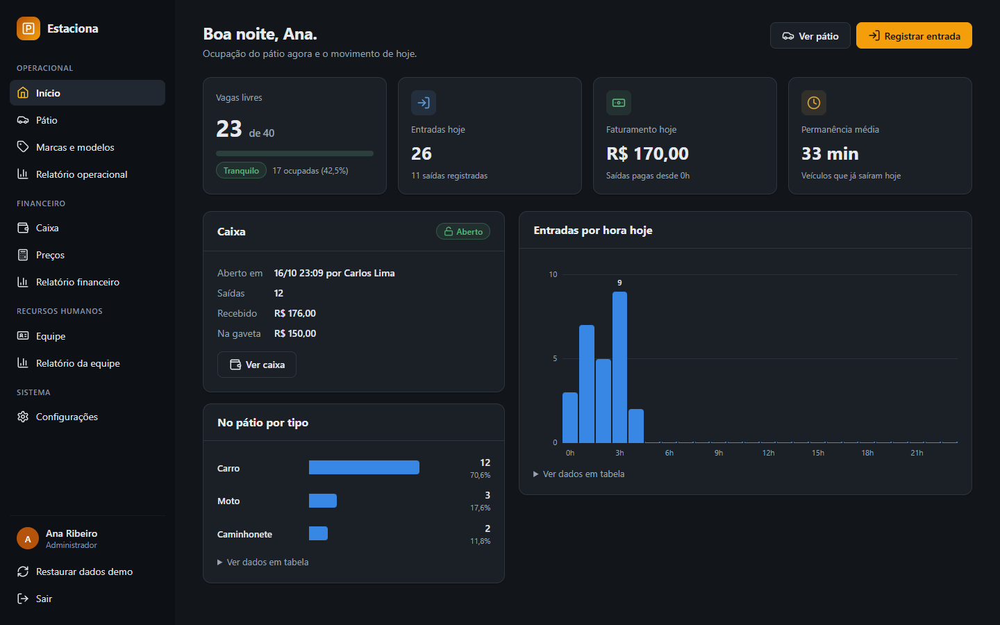

# Estaciona

Painel de gestão de estacionamento: entrada e saída de veículos com cobrança por faixa de tempo, caixa por turno, tabela de preços, cadastros de veículos e equipe, e relatórios operacionais e financeiros.



> Projeto de portfólio. Começou em 2019 como um protótipo de telas em **Angular 7** (só HTML com dados fixos, sem backend) e foi **reescrito do zero em Angular 22**, com componentes standalone, signals, Signal Forms e change detection zoneless, mais uma **API em Java 25 + Spring Boot 4**. O código original continua no branch [`legacy-angular7`](../../tree/legacy-angular7). Todos os dados são fictícios.

## Funcionalidades

| Tela | O que faz |
|---|---|
| **Início** | Vagas livres com indicador de lotação, entradas, faturamento e permanência média do dia, situação do caixa e entradas por hora. Atualiza sozinha a cada minuto. |
| **Pátio** | Veículos no pátio com tempo e valor até o momento, histórico paginado no servidor e busca por placa. **Entrada** com máscara e validação de placa (padrão antigo e Mercosul); **saída** com prévia do valor e forma de pagamento. Bloqueia entrada com o estacionamento lotado ou com a placa já no pátio, e saída com o caixa fechado. |
| **Caixa** | Abertura com troco inicial, totais por forma de pagamento, dinheiro esperado na gaveta, fechamento com conferência e histórico por período. |
| **Preços** | Tabela por tipo de veículo (quatro faixas na primeira hora + hora adicional), edição com faixas em ordem crescente e simulador de cobrança. |
| **Marcas e modelos** | CRUD com busca sem acento e filtro por marca. Uma marca com modelos, ou um modelo com movimentações, não pode ser excluído. |
| **Equipe** | Funções e funcionários, com CPF validado pelos dígitos verificadores e idade mínima de 16 anos na admissão. |
| **Relatórios** | **Operacional**: entradas por dia e por horário, permanência média, horário de pico e modelos mais frequentes. **Financeiro**: receita bruta, taxas das maquininhas, receita líquida, ticket médio e receita por forma de pagamento e tipo de veículo. **Equipe**: composição, tempo de casa e aniversariantes do mês. |
| **Configurações** | Dados da empresa (CNPJ validado), número de vagas (nunca menor que os veículos no pátio) e taxas de débito e crédito. |

Há dois perfis. O **administrador** acessa tudo. O **operador** cuida do pátio e do caixa e consulta os preços, mas não vê RH, relatório financeiro nem configurações. A regra vale no menu, nos guards de rota e na API.

| | |
|---|---|
|  |  |
|  |  |

## Stack e decisões técnicas

### Frontend: Angular 22

- **100% standalone**, sem `NgModule`, com **rotas lazy** (`loadComponent`), títulos por página e **guards e interceptors funcionais** (`authGuard`, `adminGuard`, token JWT e logout automático no 401).
- **Zoneless + signals**: `signal`, `computed`, `linkedSignal` (a página volta para 1 quando a busca muda), `input()`, `output()` e `model()`, com `OnPush` em todos os componentes.
- **`httpResource`** para leituras, com estados de carregando, erro e recarga declarativos. Ao trocar o filtro, a tela mantém os dados anteriores esmaecidos em vez de piscar.
- **Signal Forms** (`form()`, `[formField]`, validadores síncronos e entre campos) em todos os formulários, com um componente `app-field` que mostra o erro de cada campo.
- **UI própria, sem bibliotecas**: modal sobre `<dialog>` nativo, toasts, paginação, ícones SVG e **gráficos de barras em HTML/CSS** acessíveis (foco por teclado, tooltip e tabela com os dados de cada gráfico).
- **CSS com design tokens** e **tema escuro** automático (`prefers-color-scheme`). As cores dos gráficos foram validadas para contraste mínimo de 3:1 nos dois temas.
- Carregamento inicial de cerca de **95 kB** transferidos; cada tela é baixada sob demanda.

### Backend: Java 25 + Spring Boot 4

- **Spring Web MVC, Data JPA, Validation e Security**, com **JWT** (HS256) emitido pelo próprio backend e validado pelo resource server do Spring Security. As regras de acesso por perfil ficam todas em [`SecurityConfig`](backend/src/main/java/com/cristianandrade/estacionamento/config/SecurityConfig.java).
- **Regras de negócio no servidor**: cobrança por faixa ([`Cobranca`](backend/src/main/java/com/cristianandrade/estacionamento/preco/Cobranca.java)), lotação, placa duplicada, caixa aberto obrigatório na saída, exclusões bloqueadas por vínculos, idade mínima e CPF/CNPJ com Bean Validation customizada.
- **Erros padronizados** em JSON (`{ status, message, campos }`), exibidos como vieram no painel.
- **H2 em memória** com **dados de demonstração determinísticos**: 45 dias de movimento, caixas fechados e o caixa do turno aberto. Os dados são gerados a partir da data atual, então a demonstração sempre parece "de hoje".
- **Swagger UI** em `/swagger-ui.html`, com autenticação pelo botão *Authorize*.
- O mesmo jar entrega a API e o build do Angular (perfil Maven `frontend`), com fallback de rotas do SPA para o `index.html`.
- `Clock` injetado no lugar de `LocalDateTime.now()`, para "hoje" sempre seguir o fuso do estacionamento.

### Testes

| Camada | Ferramenta | O que cobre |
|---|---|---|
| Unitários do front | **Vitest** | placa, CPF e CNPJ, máscaras, datas e períodos, regra de cobrança, estatísticas da equipe e o formulário de funcionário |
| API | **JUnit 5 + MockMvc** | autenticação e perfis, fluxo entrada → saída no caixa, lotação, validações, exclusões bloqueadas, relatórios, cobrança por faixa |
| Ponta a ponta | **Cypress** | 36 cenários contra o jar real (Spring + Angular): login e perfis, pátio, caixa, preços, cadastros, equipe, relatórios, configurações e layout mobile |

Os testes E2E restauram os dados antes de cada cenário e leem os valores esperados da própria API, então nenhum número fica fixo nos testes. O **GitHub Actions** roda as três suítes a cada push e pull request.

### Estrutura

```
backend/                         # API Spring Boot (Maven Wrapper: não precisa de Maven instalado)
└── src/main/java/.../estacionamento
    ├── auth/  config/  comum/   # JWT e segurança, erros, validações, paginação
    ├── patio/  caixa/  preco/   # movimentações, turnos de caixa, tabela e cálculo de cobrança
    ├── veiculo/  rh/  empresa/  # cadastros e configurações
    ├── relatorio/               # relatórios e dashboard
    └── demo/                    # dados de demonstração e POST /api/demo/reset
src/app
├── core/                        # contratos da API, sessão, guards, interceptors e funções puras testadas
├── shared/                      # modal, toast, paginação, gráfico, filtro de período, campo de formulário
└── features/                    # uma pasta por tela (lazy loaded)
cypress/                         # testes E2E e geração dos screenshots
```

### O que mudou em relação à versão original (Angular 7)

- Telas estáticas com dados fixos no HTML → sistema funcional com API, banco, autenticação e perfis.
- `NgModule` + `ngx-bootstrap` + Bootstrap 3 e 4 carregados juntos por CDN → standalone + signals e CSS próprio, sem dependências de UI.
- Navegação por "abas" numeradas (`abaPainel === 4`) e `ngDoCheck` → rotas reais com lazy loading e guards.
- Layout com `position: absolute` e larguras fixas → layout responsivo com menu mobile e tema escuro.
- Karma, Protractor e TSLint (descontinuados) → Vitest, Cypress e CI.

## Como rodar

Pré-requisitos: **Node.js 24+** e **JDK 25**. O Maven vem pelo wrapper (`backend/mvnw`).

```bash
npm install
npm run dev
```

O `npm run dev` sobe a API em http://localhost:8080 e o painel em **http://localhost:4200** no mesmo terminal. Para rodar separado, use `npm run api` e `npm start` em terminais diferentes.

Entre com **`admin` / `admin123`** (administrador) ou **`operador` / `operador123`**. Os botões da tela de login preenchem os campos. **Restaurar dados demo**, no menu lateral, volta tudo ao estado inicial, o que também acontece quando a API reinicia.

| Comando | O que faz |
|---|---|
| `npm run dev` | API + Angular em modo desenvolvimento |
| `npm run serve:prod` | build de produção dentro do jar e `java -jar` em http://localhost:8080 |
| `npm test` | testes unitários do frontend (Vitest) |
| `npm run test:api` | testes da API (JUnit + MockMvc) |
| `npm run e2e` | gera o jar e roda os testes E2E (Cypress headless) |
| `npm run e2e:open` | o mesmo, com a interface do Cypress |
| `npm run docs:screenshots` | regenera as imagens deste README |

API documentada em http://localhost:8080/swagger-ui.html.

> Os scripts do Cypress usam [`scripts/cypress.mjs`](scripts/cypress.mjs), que remove a variável `ELECTRON_RUN_AS_NODE` herdada do terminal do VS Code. Sem isso, o Cypress falha com `bad option: --smoke-test`.

## Licença

[MIT](LICENSE)
